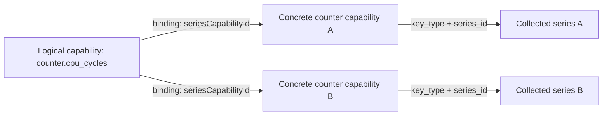

<!--
SPDX-FileCopyrightText: Copyright 2026 Arm Limited and/or its affiliates <open-source-office@arm.com>
SPDX-License-Identifier: Apache-2.0
-->

# CPU Counter Capability Contract

## Scope

This document defines the initial contract for discovering, requesting, collecting, and rendering CPU counters. Code Hotspots is the first intended consumer; recipe policy and collector-specific mappings are defined separately.

```text
Discover -> Request capability IDs -> Resolve native counters -> Collect -> Save -> Render
```

The contract initially supports `counter.cpu_cycles`. GPU capabilities are separate work. A universal counter catalogue, provider framework, counter-picker UI, and migration of all recipes are outside this contract.

## Terminology

| Term | Meaning in this contract |
| --- | --- |
| CPU counter | A hardware CPU PMU event selected for collection. Software counters are outside this initial contract. |
| Capability | A named result describing whether a tool invocation can collect a particular kind of data, or what it collected. `counter.cpu_cycles` is the CPU-cycle capability: one ID for CPU-cycle data across supported CPU PMU devices, even when the collector needs several native counter selections. |
| Tool capability | A capability discovered or saved for one tool invocation. The CPU-cycle capability and the existing concrete counter capabilities are both tool capabilities. |
| Native counter selection | The collector-specific event name or configuration chosen by the tool integration to satisfy a capability. Recipes and renderers use capability IDs instead of these selections. |
| Required capability | A capability ID requested by a recipe whose unavailability prevents collection. |
| Optional capability | A capability ID requested by a recipe whose unavailability allows collection to continue with a warning. |
| Collected capability | A saved capability in the `collected` state, published by the tool integration after it checks the collection result. |

## Capability Schema

A capability is scoped to one tool invocation. Its ID and component type remain the same during discovery and in saved capabilities:

| Property | Initial value |
| --- | --- |
| Capability map key | `counter.cpu_cycles` |
| Component type | `{name: 'tool_capabilities/cpu_counter', version: '1.0'}` |
| Meaning | CPU-cycle collection across the CPU PMU devices supported by the invocation |

Device selection and per-core requests are outside this contract. Multiple native selections may satisfy one logical capability. Resolution must cover the requested scope rather than silently selecting a subset; competing interpretations of a device's counter are ambiguous.

The CPU-cycle capability reports availability, not sampling-rate limits or other collector settings. The tool integration owns those limits and validates requested settings before collection; this initial capability payload has no minimum or maximum rate fields.

The API envelope contains `componentType`, `state`, and `payload`. The CPU payload is:

| Field | Type | Rule |
| --- | --- | --- |
| `title` | String | Exactly `CPU Cycles`; display text, not identity |
| `units` | String | Exactly `cycles` |
| `bindings` | Array | Each entry is `{seriesCapabilityId: string}` |
| `reason` | String | Present only as specified in the state table below |

A **binding** is a reference from the logical CPU Cycles capability to a concrete counter capability containing the identity of a collected data series. This lets a renderer find the data without knowing native collector counter names. One logical capability can reference several series, and each series can contain data for several devices.



Each binding references a saved `tool_capabilities/counter` version `1.0` capability in the same invocation, in state `collected`, with `key_type` and `series_id`. Binding IDs are unique strings that start with a letter or digit and may then contain letters, digits, periods, underscores, or hyphens (`^[A-Za-z0-9][A-Za-z0-9._-]*$`). Native counter selections do not belong in the CPU-cycle capability payload. This series-based representation is specific to CPU counters, not a requirement for all capabilities.

The engine validates these envelopes and rejects unknown fields, wrong types, unsupported IDs, and unsupported versions. Existing concrete-counter capabilities and unrelated probe fields retain their current schemas.

## States

| State | Where permitted | Bindings | Reason |
| --- | --- | --- | --- |
| `available` | Probe | Empty | Absent |
| `unavailable` | Probe and saved capability | Empty | `not_supported` or `ambiguous` |
| `collected` | Saved capability | Non-empty | Absent |
| `incomplete` | Saved capability | Empty or references to successfully collected data | `record_failed`, `reformat_failed`, or `output_unverified` |

Successful CPU discovery returns `counter.cpu_cycles`, including an `unavailable` descriptor when it cannot resolve the selection. The engine treats a missing descriptor as an integration-contract error. Explicit-empty requests may skip CPU discovery. Tool readiness remains separate from counter availability.

The integration determines whether collection satisfied a capability and publishes its final state. `unavailable` means the counter cannot be selected; `incomplete` means collection or analysis did not produce all the required data. The engine validates the published schema and references and enforces the request policy.

Discovery command, deployment, permission, and parsing failures are stage errors. They must not become `unavailable` descriptors, even for optional requests.

## Collection Request

The recipe supplies capability IDs through the optional `capabilityRequest` field in `ToolConfiguration`, separately from `params`:

```javascript
capabilityRequest: {
  required: ['counter.cpu_cycles'],
  optional: [],
}
```

Both arrays are required. `required` lists capabilities necessary for successful collection; `optional` lists capabilities whose unavailability need not prevent collection. Recipes do not copy probe payloads into this request. The recipe's top-level `api_version` governs the request shape; there is no separate request version field.

The engine normalizes and validates the request before passing it to the integration as `ctx.capabilityRequest`:

- Omitted or JavaScript `undefined` means existing collector defaults. Reject `null`, missing fields, unknown fields, wrong types, and unsupported capability IDs.
- Remove duplicate IDs within each list, preserving first occurrence, and reject overlap between lists.
- Leave the caller's object unchanged.

An explicit-empty request is `{required: [], optional: []}`. It disables selectable counter defaults, as does an optional-only request resolving to no counters. Normal collection and required capture metadata still apply.

Integrations declare support with `capabilityInterfaceVersion: '1.0'` on their `tool` definition. This is static support metadata, not runtime version negotiation. Tool integrations are versioned independently from the recipe API, so the declaration lets the engine reject an explicit request instead of allowing an older integration to ignore it and silently collect defaults. Integrations validate their supported option combinations before collection, including for explicit-empty requests. Never silently fall back to defaults or add counters outside the selection.

## Discovery and Resolution

Recipes can use `context.probeTools` to inspect availability. Before collection, the engine guarantees tool readiness and supplies matching discovery results as `ctx.discovery` for non-empty requests. It can reuse successful discovery while the collection context remains unchanged; otherwise it probes again. This uses the existing deployment, privilege, and locality mechanisms.

The integration resolves and deduplicates native selections from the supplied discovery results. Explicit-empty requests skip counter enumeration but still require normal tool readiness.

## Saved Requests and Capabilities

Save the requested capabilities and actual collected capabilities separately in the Run, scoped to the tool invocation:

| Run-relative path | Component type, version | Contents |
| --- | --- | --- |
| `tool/<tool>/<invocation>/requests/counter_collection.json` | `tool_requests/counter_collection`, `1.0` | Normalized `required` and `optional` ID lists |
| `tool/<tool>/<invocation>/capabilities/counter.cpu_cycles.json` | `tool_capabilities/cpu_counter`, `1.0` | Final `state` and `payload` |

Save the request before resolution or collection and keep it unchanged. It records configuration, so it lives separately from capabilities and contains no probe payloads. Persisted component versions describe the saved schema independently of the recipe API version.

For saved capabilities, the filename supplies the ID and the manifest supplies the component type/version. The Run-capability API reconstructs the envelope. Readers see only complete final capability records, including when collection fails before launch.

The integration checks that its output satisfies the requested capability before publishing `collected`. Collector-specific checks belong in the integration. The engine validates the published contract rather than independently interpreting collector artifacts.

For each requested capability:

| Condition | Saved state and behaviour |
| --- | --- |
| Required counter unsupported or ambiguous | Save `unavailable`; fail before collector launch |
| Optional counter unsupported or ambiguous | Save `unavailable`; warn and skip |
| Requested data collected successfully | Save `collected` with bindings to the data |
| Record or reformat failure | Save `incomplete` where possible; fail the Run regardless of request policy |
| Required output missing, invalid, or partial | Save `incomplete`; fail the Run |
| Only optional output missing, invalid, or partial after otherwise successful capture/analysis | Save `incomplete`; warn |

Explicit-empty requests produce a saved request and no saved CPU capability. Omitted requests retain existing behaviour and do not introduce these records. A requested ID without a saved capability, including after interruption, remains unresolved and must not be treated as collected.

## Rendering, Errors, and Compatibility

Renderers use the existing Run-capability API and CPU bindings to find collected data. Empty, unavailable, incomplete, or unresolved explicit selections must not trigger a fallback that invents complete CPU data. Saved requests remain readable as normal Run components.

Use the engine message catalogue for user-visible errors and warnings. Identify the capability or invalid request field and provide a useful next step. Keep native names, commands, and raw output in diagnostics.

Do not reinterpret existing `tool_capabilities/counter` version `1.0` records or rewrite old Runs. Incompatible saved-schema or state changes require a new component version; consumers must reject unsupported versions.

The `neoprof` tool's timeline feature was disabled by default in every released version. Runs created by manually enabling the experimental flag are not a compatibility target for this contract, so renderers do not provide a legacy fallback.

## Contract Verification

Shared contract tests should be reusable for integrations that opt in. Coverage includes:

- Successful CPU discovery returning a valid available or unavailable descriptor, with explicit-empty requests allowed to skip enumeration.
- IDs-only requests, engine-owned normalization and validation, and omitted versus explicit-empty requests.
- Matching discovery supplied before collection, changed availability, and discovery failures.
- Required/optional policy and rejection of unsupported integrations or conflicting options.
- Saved requests and capabilities remaining distinct, with bindings resolving through the Run-capability API.
- Interrupted collection or failed publication leaving a readable request without a falsely completed capability.

Recipe policy, native mappings, collector-specific output checks, and hardware acceptance belong in their respective delivery plans and tests.
