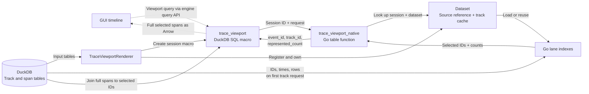
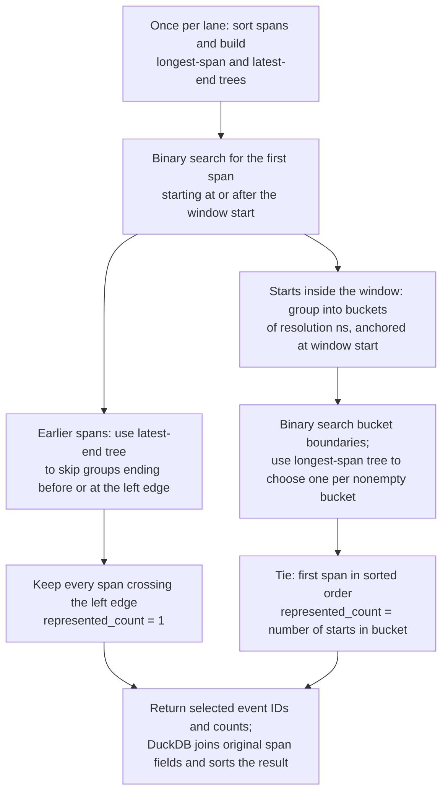

<!--
SPDX-FileCopyrightText: Copyright 2026 Arm Limited and/or its affiliates <open-source-office@arm.com>
SPDX-License-Identifier: Apache-2.0
-->

# Trace viewport architecture

`trace_viewport` selects representative trace spans for a time window and level
of detail, so the GUI can display a trace without loading every span into the
renderer process.

A compact Go index chooses which events to return. Fields not needed for
selection, such as labels, colors, parents, and flags, stay in DuckDB. A SQL
macro joins those fields back onto the selected event IDs at query time and
returns the full selected spans as Arrow.

## Engine and GUI boundary



`TraceViewportRenderer` registers a dataset using its recipe-supplied
renderer ID. It consumes `trace_tracks` and `trace_spans` inputs; it does not
emit another copy of the span table.

The GUI calls the `trace_viewport` SQL macro in the render session's schema.
The macro supplies the session identity to `trace_viewport_native`, a Go table
function registered once per shared DuckDB instance. The native function returns
only `event_id`, `track_id`, and `represented_count`; DuckDB joins these keys to 
the underlying span tables.

## SQL interface

```sql
SELECT * FROM trace_viewport(
  'execution_trace',
  1000000000::BIGINT,
  1100000000::BIGINT,
  65536::BIGINT,
  [2, 3]::BIGINT[]
);
```

Arguments:

| Argument | Type | Meaning |
| --- | --- | --- |
| `viewport_dataset` | `VARCHAR` | Registered dataset ID, matching the recipe renderer ID. |
| `viewport_start` | `BIGINT` | Inclusive window start in nanoseconds. |
| `viewport_end` | `BIGINT` | Exclusive window end in nanoseconds; must exceed the start. |
| `viewport_resolution` | `BIGINT` | Positive start-time bucket width in nanoseconds. Larger values select coarser detail. |
| `viewport_tracks` | `BIGINT[]` | Requested span-track IDs, normally the tracks visible in the GUI. |

The result contains the original span columns: `event_id`, `track_id`,
`start_ns`, `end_ns`, `row`, `name`, `parent_event_id`, `color_key`, `color`, and
`flags`, plus `represented_count`. Results are ordered by track, lane (`row`),
start, end, and event ID. Selected spans retain their original timestamps;
they are neither clipped to the window nor replaced by bucket boundaries.

For each lane, selection includes:

- Every span starting before the window and ending after its left edge, each
  with `represented_count = 1`.
- The longest span whose start falls in each nonempty bucket within the window.
  Buckets are anchored at the requested start and the last is bounded by the
  exclusive end. Equal-duration ties use the first span in sorted order
  (`start_ns`, `end_ns`, then `event_id`). Its `represented_count` is the number
  of span starts in that bucket, including the selected span.

## Lane selection

Within each track, a **lane** is one row of spans. Its events are sorted by start
time, then end time and event ID. The index stores numeric arrays and two trees
of summaries over event ranges: one records the longest span, the other the
latest end time. These summaries let queries skip or combine groups of events.



## Index ownership and loading

Renderer initialization reads track IDs but does not build the index.
The first query for a track reads its event IDs, start/end timestamps, and lane
numbers over the track's entire time range. Each dataset caches the resulting 
lane indexes for later queries.

Lane indexes are immutable: changing the underlying span table is not supported.

Memory grows with the tracks visited during a session.

Closing the renderer unregisters its dataset, cancels active work, and releases
the retained indexes before the session's source schema is removed.

## GUI integration

A recipe adds `TraceViewportRenderer` after its canonical trace producers,
connecting their track and span outputs to its `tracks` and `spans` inputs.
The visualization's `rendererId` and trace group's `datasetId` identify this
renderer. The timeline group keeps its table sources, `trackSourceKey`,
`spanSourceKey`, and nanosecond `timeDomain`.

The initial query loads track metadata for the hierarchy and row layout.
Viewport queries then request visible span tracks at a power-of-two resolution,
with a padded time window that can be reused while panning. Scrolling, zooming,
and resizing update the requested viewport; finer results progressively replace
coarser ones. The GUI draws the selected spans directly without building its
own lane indexes. 

Configurations without `datasetId` retain the full-data path, with the GUI
building its own mipmap, as a fallback.
