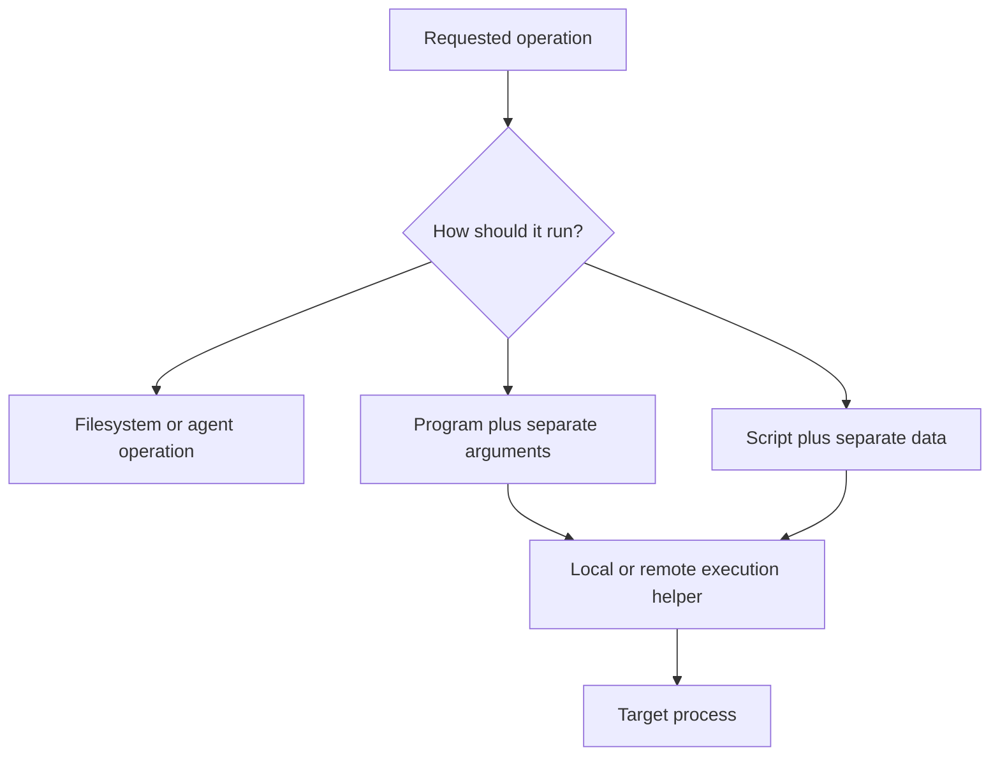
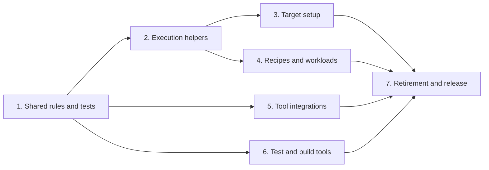

<!--
SPDX-FileCopyrightText: Copyright 2026 Arm Limited and/or its affiliates <open-source-office@arm.com>
SPDX-License-Identifier: Apache-2.0
-->

# Safe command execution: design and delivery plan

## Problem and intended outcome

Arm Performix runs programs to prepare targets, launch profiling workloads and
process results. These operations accept paths, environment values and arguments
from users, configuration and target systems. When those values are inserted
into script text, quotes and special characters such as `&` and `;` can change
the command's meaning and cause unintended commands to run.

The design reduces the need to execute a shell and keeps data separate from
script text where a shell remains necessary. Paths and ordinary arguments must
reach the intended program unchanged. Intentional recipe scripts and explicitly
requested shell workloads remain supported.

This plan defines how commands should run locally and remotely, the order of the
changes, and how we will check that they work. It covers product execution and
supporting test/build tools at the level of shared behaviour and interfaces.

Status: design proposed for review

## Security scope

The problem is that a value intended as data can change the instructions
Performix runs. This can cause accidental execution, for example when a path
contains shell syntax. It can also allow malicious injection if someone can
supply data that another operator uses to run an operation. That security impact
depends on who controls the input and where it is used; it is not established
merely by finding values being inserted into command text.

An operator already authorised to run arbitrary commands at the same privilege
level gains no extra capability by injecting a command. This design protects the
operator's intended operation; it does not prevent deliberate shell use. Running
with elevated privileges can increase the consequences of an unintended command,
but does not by itself show that someone can gain permissions they did not have.

For each suspected security issue, record who controls the input, how it reaches
execution, whether it runs on the host or target, and the permissions it runs
with. Use a harmless example to demonstrate the problem. Explain whether it
causes incorrect behaviour or also gives an attacker a way to run commands.

## Approach

Choose how to perform each operation in this order:

1. **Use a filesystem or target-agent operation.** Checking a file, creating a
   directory or listing files should use an existing operation where available.
   Extend agent capabilities when a reusable operation removes repeated shell
   logic and has clear behaviour and permission requirements.
2. **Launch a program directly.** Pass its executable, arguments, environment and
   working directory separately through the process API.
3. **Use a script when needed.** Scripts supplied by Performix keep their text
   fixed and receive values through separate arguments, environment variables or
   request fields. User and recipe scripts remain clearly identified as scripts.
4. **Quote values for the shell when a command string is unavoidable.** Setting up
   a remote target before its agent starts can still require a shell command.
   Shared execution helpers must handle the quoting rules of that shell.

One function that “cleans” every input cannot meet these requirements. Different
shells interpret text differently, and stripping special characters would change
valid paths and arguments.



### Examples of the migration

| Existing approach | Intended replacement |
| --- | --- |
| Build a shell command to create a directory from a supplied path. | Call a filesystem or agent directory-creation operation with that path. |
| Join environment assignments, an executable and arguments into a command string. | Pass the executable, argument array and environment as separate process fields. |
| Insert paths into a Performix script that pipes output between programs. | Keep the script text fixed and pass the paths as separate arguments. |

Most work is in internal target preparation, execution helpers and integrations.
Agent extensions should remove repeated shell operations where useful; there is
no requirement to replace every deliberate script with a new agent operation.

## Scope and agreed decisions

The work covers target setup, engine and agent execution, recipes, workloads and
tool integrations. It also covers inputs supplied by the graphical interface
(GUI), command-line interface (CLI) and remote procedure calls (RPCs). Test and
build tooling is migrated in separate changes.

1. Preserve legacy recipe `cmd` as a script and preserve explicit `--use-shell`.
   Values supplied as data must not be interpreted as shell instructions.
2. `UseShell=false` must run the chosen executable with its separate arguments.
   Decide once whether to use a shell; later helpers must not add one automatically.
3. Initial target setup must work without a running target agent, Python installation or
   PowerShell 7. Verify supported Windows PowerShell environments before selecting
   how to pass arguments to programs.
4. Prefer existing filesystem and agent RPC operations. Existing agent fields
   already represent arguments, environment and working directory. Any public
   workload API with separate argument fields must be reviewed separately and added
   alongside the existing API.
5. Keep the work within core and the existing GUI bridge. No plugin-system changes.

### Non-goals

This work does not limit what user-supplied recipes can do, restrict the
programs a user may intentionally run, change how elevated permissions are
approved, replace collectors, or redesign all the rules for interpreting CLI
input. General HTML and SQL sanitisation are outside scope.

## Rules for running programs and scripts

### Process and script requests

Use separate operations for programs and scripts. These names are examples;
reuse existing types and interfaces where practical.

```text
RunProcess(context, request)
    command: nonempty array; executable followed by arguments passed unchanged
    environment: values to set in the target environment, passed unchanged
    workingDirectory: target path, passed unchanged
    asPrivileged: follows the existing rules for elevated permissions

RunScript(context, request)
    shell: chosen supported shell and its command syntax
    source: intentional script text
    arguments: data passed unchanged, where supported by the shell
    environment / workingDirectory / asPrivileged: same process options
```

The script operation starts the chosen shell. It does not grant extra
permissions. Preserve standard output and error streams, exit codes,
cancellation, output redirection and the existing worker used for commands
requiring root permissions. Report separately when a program cannot start, when
it exits with an error, and when communication with the target fails.

### What source and data mean

**Source** is script text that a shell interprets as instructions, including
pipes, redirects and substitutions. **Data** is a value passed to a program: an
argument, an environment value or a path. “Literal” means preserving that value
unchanged, without treating its contents as shell instructions.

There is no generic `data` field. Process requests use the separate `command`,
`environment` and `workingDirectory` fields above; script requests also have
`arguments`. A direct process request has an executable, not shell source.

For example, these requests both print `&` on a POSIX system such as Linux or
macOS:

```text
RunProcess(command = ["printf", "%s\n", "&"])

RunScript(shell = "sh", source = "printf '%s\n' \"$1\"", arguments = ["&"])
```

In the second request, the execution helper supplies the first argument as `$1`.
The shell interprets the fixed `printf` instruction and `"$1"`; the ampersand
supplied as `$1` remains data. It does not become a shell operator.

The caller chooses the process or script operation. Choosing a script is not
permission to insert values into its text: scripts supplied by Performix stay
fixed and the execution helper passes values separately. Intentional user and
recipe scripts remain executable source, including their requested shell
operations.

### Data handling rules

| Area | Required behaviour |
| --- | --- |
| Arguments | Preserve order, empty arguments, whitespace, quotes, Unicode and trailing backslashes. Never split or shell-quote an existing argument array. |
| Executable | Reject a missing or empty executable. Preserve the existing rules for finding the program on the target. Never retry a failed direct launch through a shell automatically. |
| Environment | Pass values unchanged. Reject empty names, names containing `=`, and the NUL (zero) character in names or values. Treat Windows environment names consistently regardless of letter case. Report any stricter limits imposed by the execution method. |
| Paths | Set the working directory through the process API where possible. Adjust path separators for the target only in path fields, never across whole commands or scripts. |
| PATH | Preserve the target's existing PATH. To use a virtual environment, add its directory to that value without inserting shell instructions. Check both which program is found and the PATH it receives. |
| Unsupported values | Reject NUL in executable, arguments and working directory before launch. Report other platform limitations without silently changing values. |
| Scripts | Pass data separately from Performix script text. Interpret text as shell instructions only when a script was requested. |
| Encoding | Apply the required quoting once for each shell that reads the command. Callers supply original values, without shell quotes already added. JSON or Go string quotes do not replace shell quoting. |
| Options and patterns | Account for the called program's option syntax. Use an end-of-options marker such as `--` where supported, or absolute paths where appropriate. Keep directory paths separate from filename patterns such as `*.txt`. |
| Validation | Check inputs in the engine and agent, including direct RPC requests. Checks in the GUI alone are insufficient. Check that values have the required type, such as an integer setting, before passing them to an operation; quoting a whole script does not protect values inserted inside it. |
| Diagnostics | Display text is never reused for execution. Do not include environment values or requests containing credentials in command logs or errors. |

### Credential handling

Quoting a value for a shell does not keep it secret. Authentication values must
not appear in SSH command text, process arguments, logged requests or errors, or
saved repository remote URLs and Git configuration.

Use a dedicated credential mechanism for target-side Git operations, such as a
temporary credential helper or askpass program that supplies a token when Git
requests it. The implementation must define how the credential reaches that
mechanism without being embedded in command text, limit access and lifetime, and
clean up temporary resources on success, failure and cancellation. Do not put
the token in the helper's arguments or source.

Verify these requirements using a dummy token, including clone, fetch and
failure paths. Hiding secrets in logs alone does not meet this requirement. This
protects against avoidable disclosure; it does not conceal credentials from an
administrator who controls the machine running the authenticated operation.

### Agent capabilities

Prefer filesystem or agent operations for tasks, including directory creation,
file checks and listing. Reuse current capabilities before adding new ones. An
extension should define whether paths are exact names or patterns, permissions,
error handling and platform support. It should represent a useful operation,
rather than provide another way to send arbitrary shell commands.

Keep initial setup separate: operations needed to start the agent cannot depend
on that agent already running. Once it is available, use its structured process
and filesystem interfaces where appropriate.

## Local and remote execution

| Execution path | Design |
| --- | --- |
| Local Linux/macOS (POSIX) | Use the process API with separate arguments, environment and working directory. Launch a shell only for an explicit script request. |
| Local Windows | Use the Windows process API to launch programs. Use separate helpers for PowerShell and supported cmd/batch scripts, following each shell's argument rules. |
| Agent RPC | Keep request fields separate when sending them to the agent. Preserve process start, stop, cleanup and permission handling. |
| SSH to POSIX | The SSH server still interprets a command string. Use a tested quoting helper to build the final command from fixed script text and separate values. Do not depend on server environment forwarding being enabled. |
| ADB | Preserve host-side arguments and encode the target command for the supported Android shell. Separate host arguments still need protection from interpretation by the target shell. |
| SSH to Windows and initial Windows setup | Use a fixed helper script receiving separate data fields. Encode the command for transmission or copy the script to the target first where required. Decode values into process options; do not run them as script text. |

For a fixed POSIX script, pass paths as numbered arguments instead of inserting
them into the script:

```text
command = ["sh", "-c", FIXED_SCRIPT, "apx-script", sourceDir, destinationDir]
FIXED_SCRIPT reads "$1" and "$2" as data
```

For PowerShell, a fixed script can read separate environment values and use
operations that treat paths as exact names, not wildcard patterns. Encoding a
script for transmission does not protect values already inserted into its text.

Windows verification must cover the SSH server shell, PowerShell source parsing
and the target executable's native command-line parsing. Select the
implementation against the supported Windows and PowerShell versions. Where the
process API cannot accept a list of separate arguments, use tested argument
encoding or a fixed helper. Unsupported combinations must fail clearly rather
than fall back to unsafe command construction.

## Compatibility and external programs

Keep the original workload input for display and history. Resolve its execution
mode once, then use the resulting arguments for execution. Do not reconstruct a
command from display text, normalize slashes across an entire command, or split
arguments on whitespace after they have already been parsed.

### CLI, GUI and recipe behaviour

| Interface or mode | Intended behaviour |
| --- | --- |
| CLI with explicit `--use-shell` | Continue to interpret the workload as shell source. |
| GUI workload with `UseShell=false`, or other direct process request | Launch the resolved executable and arguments without an automatic shell wrapper. |
| Explicit interpreter workload, such as `sh -c` with script text as an argument | Continue to allow it as a deliberately selected program. Direct mode does not ban interpreters or sandbox the workload. |
| Legacy recipe `cmd` | Continue to treat the field as a script. |

Ordinary paths, environment values and arguments should work unchanged,
including special characters. Callers that relied on unintended implicit shell
expansion must choose explicit script execution instead. Identify those changes
during migration and document user-facing corrections in release notes.

Add recipe operations with separate arguments alongside existing script
operations. Existing recipe script fields retain their meaning while internal
callers migrate to direct operations.

### Legacy command strings and external programs

New internal process and argument interfaces use arrays, with a separate entry
for each argument. Use JSON arrays of strings when the interface can only carry
text. Read these arrays without running their contents through a shell. Any new
public workload API still needs separate review and must sit alongside the
existing API. Fields that contain intentional scripts keep their meaning.

Existing string interfaces remain available, with documented rules for turning
text into arguments that preserve their existing behaviour. Before migration,
establish their current parsing rules and callers, and define exactly how text
becomes arguments, including empty arguments, spaces, quotes and backslashes. If
their parsing behaviour cannot preserve argument boundaries, add an interface
with separate argument fields and a migration plan before retiring the old
input. Preserve documented existing behaviour during that transition. Whitespace
splitting is not a parser for quoted command lines. Do not run input through
a shell to turn it into arguments. Keep built-in default arguments as arrays
rather than joining and splitting them.

Some external tools accept a whole command line as one argument. That means the
tool interprets the text again, even when Performix launches it directly. Define
and test how arguments are converted to text against the tool's documented or
observed parsing rules. If the external interface cannot preserve the required
values, document the limitation or the change needed in that external tool.

## Delivery plan

Deliver small changes by responsibility. Each phase includes behaviour-focused
tests and a clear compatibility statement.

| Phase | Work | Completion criterion |
| --- | --- | --- |
| 1. Shared rules and tests | Define shared validation and add a small test program reporting arguments, selected environment values, working directory and exit status. | Tests detect changed data and unintended execution on supported platforms. |
| 2. Execution helpers | Add local and remote execution helpers that accept separate argument fields and distinguish programs from scripts. Test initial Windows target setup before switching callers to the new helpers. | The same request preserves its meaning through each supported execution helper, including before the agent starts. |
| 3. Target setup | Move file checks, deployment, extraction, cleanup and initial setup to filesystem/agent operations or fixed helper scripts. | Target preparation works with unusual legal paths while preserving permissions, cleanup and startup communication. |
| 4. Recipes and workloads | Separate environment and directory handling from scripts; preserve virtual environments and permission handling; apply shell selection once and define legacy string parsing and compatibility. | Legacy scripts work, direct workloads stay direct, and data cannot become script instructions. |
| 5. Tool integrations | Replace repeated filesystem shell logic, use direct program launches, and pass data separately to remaining scripts. Extend agent operations where useful. | Migrated operations preserve output, no-match, permission and failure behaviour; external tools interpret arguments as intended. |
| 6. Test and build tools | Review helpers in test runners, remote setup, evaluation and CI that insert variable inputs into commands. Keep intentional test/build scripts explicit; fix conversions that lose argument information, check setting types and protect target Git credentials. | Automation keeps arguments separate, rejects settings with invalid types, and keeps credentials out of command text, logs and repository configuration. |
| 7. Retirement and release | Remove obsolete command builders and document the supported interfaces and compatibility changes. | Remaining shell execution is intentional and tested; external limitations and deferred work are documented. |


Phase 6 focuses on helpers that insert variable paths, arguments or credentials
into commands. It does not require replacing all CI or Robot shell scripts with
agent APIs. Use existing filesystem or agent operations where available; where
SSH or a shell is necessary, keep command text fixed and pass values separately
or quote them for that shell. For example, an SSH helper that creates a directory
must handle the supplied path safely, but need not depend on a running agent.
Deliver these fixes separately from product changes and agree their scope before
implementation.



Tool integrations can migrate using existing agent capabilities before the
initial setup helpers are complete. Test/build changes remain separate from
product fixes, but must be completed or explicitly assigned to follow-up work.

Keep using the error message catalogue and the existing rules for elevated
permissions. Verified security fixes should not leave an unsafe fallback behind
a feature flag. Deliver larger compatibility changes separately if they need a
gradual rollout.

## How we will test the changes

Check the values received by the running program and what it actually does, not
just the command text generated by a helper. For example, use a test value that
would create a temporary marker file if accidentally run as a command, and check
that the file is not created. Never use destructive test commands.

| Dimension | Coverage |
| --- | --- |
| Literal data | Empty arguments, spaces/tabs, quotes, shell special characters, carriage returns and newlines, Unicode and trailing backslashes. Use filesystem-legal characters for path tests; test other characters as arguments or environment values. |
| Invalid requests | Missing executable, NUL, invalid environment names and settings with invalid types fail before launch. |
| Legacy input parsing | String inputs preserve the documented separation between arguments; cover spaces, empty arguments, quotes and backslashes, plus migration to separate argument fields. |
| Credentials | A dummy token is absent from SSH command text, process arguments, logs, errors, remote URLs and saved Git configuration. Temporary credential resources are restricted and cleaned up on success, failure and cancellation. |
| Directory and PATH | Relative/absolute directories, Windows drive changes and supported network paths (UNC); the existing PATH and virtual environment search order. |
| Intentional scripts | Pipes, redirects and substitutions work when requested; separately supplied data remains literal. Verify CLI shell mode, direct GUI/CLI workloads and explicitly launched interpreters. |
| Utility behaviour | Leading hyphens, wildcard characters, no matches and partial output. |
| Process behaviour | Missing programs, nonzero exits, timeouts, cancellation, output streams, privileges and cleanup. |
| Execution methods | Local macOS/Linux/Windows, supported POSIX/Windows SSH configurations and real Android ADB execution. |
| External programs | Tools that accept a whole command string preserve the intended workload and directory, or report documented limitations. |

Test individual helpers and interfaces first, then run tests with real shells
and targets. Exercise both recipe JavaScript bindings and direct RPC
entrypoints. A passing POSIX test does not establish Windows correctness. Use
the repository's documented development and test workflows rather than
duplicating commands in this spec.

## Acceptance and review

Implementation is complete when ordinary data cannot become extra commands,
intentional scripts retain their documented behaviour, and the supported
execution methods pass the tests above. Document external limitations and
unfinished work. We cannot claim the whole operation is safe unless we have also
checked how any external tools interpret the commands they receive.

Each implementation review should state:

- The operation changed and its before/after behaviour.
- Changes to interfaces, existing behaviour and permissions. For a security claim,
  explain who controls the input, where the command runs and how the attack works.
- Test results and the actual platforms and shells exercised.
- Any external dependencies, unsupported cases and release impact.
